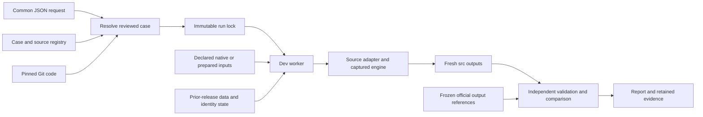

# Common historical replay interface

Status, November 6, 2026: implemented; integration validation in progress. Production is unchanged. This first interface runs the characterized historical cases with their pinned legacy settings. It does not prepare arbitrary new releases, assign production IDs, execute insertion or promote a candidate.

## One request and configuration

The operator supplies the seven fields in [request.schema.json](request.schema.json). The resolver selects one exact source/version/case, resolves the engine to a full Git commit, validates the complete common configuration, and freezes the case, dependency manifests, source code, shared runtime and apparatus. Unknown fields, aliases such as `previous_version`, unsupported profiles, unreviewed revisions and unsupported cases fail before execution. Duplicate JSON keys and placeholders are rejected.

The [case catalog](case-catalog/index.json) currently contains NCIt October 2026 with the separately reviewed PT/order fixes; unchanged SNOMED September 2026; unchanged MTH 2026AA; and the separate MTH retained-identity correction, whose execution gate remains closed pending integration of its now-passing correction audit into the common adapter acceptance profile. MDR and RADLEX remain registered with their captured production contracts, but have no executable historical case yet.

For example, save this as `request.json`:

```json
{
  "schema_version": 1,
  "source": "SNOMEDCT_US",
  "version": "SNOMEDCT_US_2026_09_01",
  "engine_ref": "3b125edc1d29f7c7a91673da2a8d752bb0adff44",
  "case_variant": "as-produced",
  "reference_stage": "inversion-src",
  "comparison_profile": "exact"
}
```

Run these commands from a checkout of the review branch `test/inversion-replay-toolbox` (or a later integration containing its committed apparatus). The original workspace on `main` can contain documentation mirrors without that committed apparatus.

Install [the pinned resolver dependencies](../../tools/requirements-runner.txt) in a local Python 3.12 virtual environment. Remote execution uses the dev server's Python 3.9 standard library. Then:

```sh
python3 -B tools/inversion_request.py resolve request.json --run-id sct-replay-001 --output case.lock.json
python3 -B tools/inversion_request.py show case.lock.json
```

The resolver requires committed apparatus, schemas and case files; uncommitted worktree bytes cannot be labeled as code from HEAD. A lock file is created once, owner-readable and non-writable. Its content digest detects subsequent changes. This is integrity/provenance evidence within the trusted repository/account workflow, not a cryptographic signature or an authorization boundary against someone who controls that account.

## Data flow



Executable code comes from Git. A prior release contributes only its declared data or identity dependencies. An official current-version output contributes comparison evidence. An existing dev run of that same version is preserved separately before replacement.

## Dev lifecycle

Use an existing authenticated SSH control socket; no password is placed in a command or configuration. `--socket` below means that socket's actual local path.

```sh
python3 -B tools/inversion_remote.py --socket /path/to/dev.sock inspect-current case.lock.json --output previous-source.json
python3 -B tools/inversion_remote.py --socket /path/to/dev.sock activate-runtime case.lock.json --output runtime-activation.json
python3 -B tools/inversion_remote.py --socket /path/to/dev.sock submit case.lock.json --previous-receipt previous-source.json --output launch.json
python3 -B tools/inversion_remote.py --socket /path/to/dev.sock status --source SNOMEDCT_US --run-id sct-replay-001 --output status-001.json
python3 -B tools/inversion_remote.py --socket /path/to/dev.sock collect --source SNOMEDCT_US --run-id sct-replay-001 --output result-001.json
```

`inspect-current` is needed only when the canonical release folder already exists. Its previous-source receipt concerns the existing dev run of this same version; it is separate from `replacement_baseline`, `comparison_baseline` and prior-release identity inputs. It pins that predecessor's files, links and access modes; an unfinished run or changed predecessor is rejected. `submit` preserves the verified tree at `<version>.before-<run-id>` and stages a fresh candidate using Git code and declared input artifacts. Successful preservation masks write access while retaining existing read/execute restrictions. A preparation failure restores the old canonical tree if no new candidate was published; partial published candidates and their logs remain available for investigation. Run IDs, preserved folders, local evidence files and control records are never reused or overwritten.

Runtime activation is a separate explicit operation under the same global dev lock. It supports only the characterized original/stable-order `Hierarchy.pm` pair, verifies all 169 runtime files and preserves the previous bytes/receipt. Other runtime differences require review. An active inversion blocks activation and submission. No production path or host is accepted.

The worker holds the same runtime lock from preparation through comparison, including the handoff from launcher to worker and calls into the source adapters. Conversion processes have network disabled, bounded memory/time, disk/memory reserves and retained stdout/stderr. Archived input acquisition is the separate network-enabled step, using the existing download-only S3 helper and `meme` profile. Cached files are verified by their frozen hashes; a changed archive or prepared bundle cannot silently replace the selected input. A missing archive with a retained reference receipt remains subject to the existing acquisition tool's conservative restore guard and requires reconciliation rather than implicit re-freezing.

All data, code and output paths retain `/local/content/MEME/MEME5/...` and the canonical source/version layout. One explicit addition is `/local/content/MEME/MEME5/inv/qa/replay-requests/<run-id>` for persistent request/control evidence. Those records must survive replacement of a release directory. The inner legacy run records remain at their original source-specific QA paths. This addition does not relocate source data or inversion outputs.

## Comparison and coverage

The reference is selected per output, not by assuming the archive is one workflow stage. NCIt uses October `src`; SNOMED uses `src/attributes.orig` before insertion enrichment; MTH uses its frozen six core outputs plus identity/history/helper outputs. The reference archive is never restored wholesale as the candidate. MTH prepared subset inputs and prior MTH_2025AB identity state are explicit dependencies; regeneration of those preserved inputs is not required.

`exact` cannot inherit a more permissive adapter verdict. NCIt's `semantic-strict` case retains its reviewed detailed rules for context ordering and generated CONTEXT attribute IDs; atom/relationship/merge content, duplicate counts, ID allocation checks and independent validation remain mandatory. MTH's original validation findings remain visible even when all official files match exactly. The correction case cannot acquire a passing verdict just by matching its own first run.

The first adapters stage already characterized legacy settings. General new-release configuration generation, policy extraction, metadata acquisition, legacy database QA, MDR/RADLEX characterization and production release management are subsequent work. Four real request locks have now been resolved and verified from committed apparatus `181ac6e`; see [resolution evidence](common-interface-resolution-20261106.json) and [executable request examples](request-examples/). The [MTH capsule-equivalence check](common-mth-capsule-equivalence.json) confirms that its common adapter resolves the same 57 code/link entries, 169 runtime hashes, frozen inputs and stage options as the executed correction capsule. This establishes translation coverage without relabeling the earlier execution. Full replay through this new common launcher is a separate integration gate; completed characterization runs retain their original apparatus identities and are not relabeled as common-run executions.
