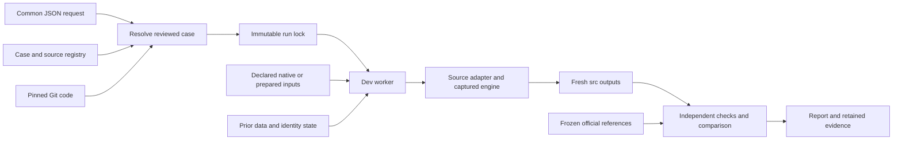

# Common historical replay interface

Status, November 9, 2026: historical adapters and accepted full common executions exist for NCIt, SNOMEDCT_US, MTH, MDR and RADLEX. Six executions cover those five sources, including both RADLEX runtimes. Their retained artifacts and the 169 restored original runtime files pass the [final independent verification](common-matrix-final-verification-20261109.json). Production is unchanged. This interface executes reviewed historical cases; new-release configuration generation, live ID allocation, insertion and production promotion remain later work.

The subsequent [NCIt generated-configuration integration](nci-configuration-generation.md) also passes: canonical Git code and common-model settings produce the same five output hashes. It is separate evidence after the six-case baseline matrix, with its own final verification and preserved predecessor.

The later [SNOMED/MTH generated-settings execution](generated-settings-execution.md) also passes independent retained-file verification. SNOMED has an uninterrupted exact common run; MTH completes native generation/comparison, followed by a separately accepted finalization review after correcting the common post-verification call. Original failed worker/batch/verifier records remain failed. This distinction is retained in every result and does not authorize operational release creation.

## One request and configuration

The operator supplies seven fields from [request.schema.json](request.schema.json):

```json
{
  "schema_version": 1,
  "source": "SNOMEDCT_US",
  "version": "SNOMEDCT_US_2026_09_01",
  "engine_ref": "3b125edc1d29f7c7a91673da2a8d752bb0adff44",
  "case_variant": "as-produced",
  "reference_stage": "inversion-src",
  "comparison_profile": "exact"
}
```

The resolver selects an exact reviewed source/version/case, resolves the engine to a full Git commit, validates the common configuration and freezes code, runtime, inputs, references and apparatus. The [case catalog](case-catalog/index.json) and [request examples](request-examples/) include NCIt October 2026 with PT/order fixes and a generated-configuration case; unchanged SNOMED September 2026 and its generated-configuration case; original/corrected MTH 2026AA plus a corrected generated-configuration case; corrected MDR 29.1; and original/stable-runtime RADLEX 4.3. The original MTH case retains its reference findings; the completed integrations below identify the actual cases executed.

The [generated-settings execution record](generated-settings-execution.md) distinguishes the later SNOMED/MTH cases from the earlier accepted historical matrix. Both generator modules travel with the frozen worker; generated files and their construction dependencies are checked before and after conversion.

All sources use the same names for replacement/comparison baselines, source-data stage, saved identity, publisher history, source atom bounds and reference stage. Genuine differences use typed `source_options`: the reviewed SNOMED case requires `rf2_view: Snapshot`, MDR requires `language: ENG`, and these NCI/MTH/RADLEX cases use empty options. Unknown fields, duplicate JSON keys, placeholders, unsupported profiles, unreviewed engines and unsupported cases fail before execution. Registering another source does not enable an adapter by itself.

Use the review branch `test/inversion-replay-toolbox` or an integration containing its committed apparatus. Source engines are separate pinned revisions: production capture `3b125ed`/additional capture `36f1e10`, NCIt PT/order candidate `bfda2ce`, MTH correction `b2611ab`, and MDR correction `dd7ae66`. The required engine commits must exist in local Git. Publishing the runner branch alone does not publish an otherwise unreachable source-engine commit. Earlier prototype automations do not define these contracts.

Install [the pinned resolver dependencies](../../tools/requirements-runner.txt) in an isolated Python 3.12 environment; remote workers use dev Python 3.9 and its standard library. From the review checkout:

```sh
python3 -B tools/inversion_request.py resolve request.json --run-id sct-replay-001 --output case.lock.json
python3 -B tools/inversion_request.py show case.lock.json
```

The resolver requires committed apparatus, schemas and case files; uncommitted bytes cannot be labeled as HEAD. Locks are created once, owner-readable and non-writable, with a content digest and frozen provenance. These provide integrity evidence within the trusted repository/account workflow, not a cryptographic signature against an account owner.

## Data and code roles



Git supplies executable code. Prior releases contribute only declared data or identity dependencies. Official current-version outputs supply comparison evidence. The existing dev tree of that same version is a separate predecessor to preserve. It is not the replacement baseline or the comparison oracle. NCIt's reviewed October case explicitly replaces August; no calendar-month inference is used. MTH requires its saved 2025AB CUI map and preserved prepared subset. MDR uses its saved publisher history inventory rather than an inferred prior folder dependency.

References are selected per output. NCIt uses October `src`; SNOMED, MDR and RADLEX use pre-insertion `src/attributes.orig`, retaining their original semantic type. MTH compares 23 characterized core/state/helper outputs. The `insert` folder is not the oracle. Completed official outputs are not seeded into fresh candidates. A preserved, hash-verified input bundle is sufficient; recreating its historical database or input-generation runtime is optional additional coverage.

RADLEX's `source_atom_ids.bound_kind` is `historical-emitted-range`. The known emitted IDs do not establish a production reservation end, and the worker rejects that relabeling. No case makes a new production allocation.

## Dev lifecycle

Use an authenticated SSH control socket. No password belongs in a request or command.

```sh
python3 -B tools/inversion_remote.py --socket /path/to/dev.sock inspect-current case.lock.json --output previous-source.json
python3 -B tools/inversion_remote.py --socket /path/to/dev.sock activate-runtime case.lock.json --output runtime-activation.json
python3 -B tools/inversion_remote.py --socket /path/to/dev.sock submit case.lock.json --previous-receipt previous-source.json --output launch.json
python3 -B tools/inversion_remote.py --socket /path/to/dev.sock status --source SNOMEDCT_US --run-id sct-replay-001 --output status-001.json
python3 -B tools/inversion_remote.py --socket /path/to/dev.sock collect --source SNOMEDCT_US --run-id sct-replay-001 --output result-001.json
```

When the canonical release folder exists, `inspect-current` pins its complete file/link/mode manifest. `submit` preserves the verified tree at `<version>.before-<run-id>`, masks write access while retaining existing access restrictions, and stages fresh Git code plus declared inputs. Preservation/preparation occurs once. An unfinished or changed predecessor is rejected. If preparation fails before publishing a candidate, the previous canonical tree can be restored; published partial candidates and logs remain evidence. Run IDs, preservation destinations, local evidence files and control records cannot be reused or overwritten.

The worker holds one global runtime lock from preparation through conversion, comparison and any mandatory audit. Runtime activation uses the same lock and supports only the reviewed original/stable-order `Hierarchy.pm` pair. It verifies all 169 runtime files and preserves previous bytes and receipts. Other changes require review. Active inversions block activation/submission; the host/account guards reject production execution.

Native stages run offline with bounded time/address space, retained stdout/stderr and a 12 GiB disk/2 GiB memory reserve. Reviewed free-space floors are NCI 18 GiB, MTH 45 GiB, MDR 20 GiB and RADLEX 18 GiB; unreviewed profiles retain the 50 GiB default. Initial memory remains 24 GiB. These source/version-specific budgets preserve older trees and do not change stage reserves. [MTH measurements](common-integration-capacity-20261109.json), [additional-source measurements](additional-common-capacity-20261109.json).

Archive acquisition is a separate network-enabled step using the existing download-only S3 helper and `meme` profile. Cached archives and prepared bundles must match frozen hashes. A missing archive with an existing reference receipt requires reconciliation through the acquisition tool's conservative guard; it is not silently re-frozen.

Data/code paths remain `/local/content/MEME/MEME5/...` with canonical release folders. Persistent common controls live at the explicit additional path `/local/content/MEME/MEME5/inv/qa/replay-requests/<run-id>`, outside a replaceable release tree. Inner source-specific QA paths remain intact. `collect` retrieves JSON reports, raw correction evidence and execution receipts; generated `.src` files remain in the standard dev `sources/<version>/src` folder.

## Comparison and correction acceptance

`exact` cannot inherit a more permissive adapter verdict. NCIt's `semantic-strict` profile requires exact atoms/relationships/merges, complete context records, proved generated CONTEXT-ID correspondence, duplicate counts, equal allocation spans and independent validation. RADLEX also requires exact atoms/relationships/merges and complete context/attribute equivalence under its reviewed ID mapping. Mandatory fields cannot be ignored merely to obtain a pass.

Corrected MTH/MDR use `reviewed-corrections`. The worker first preserves the complete raw `DIFFERENCES_REQUIRE_REVIEW` result as read-only `raw-result.json`. It runs the pinned native-input-derived audit offline under the same runtime lock, retaining the current `tomcata` account in the network namespace. The report must bind this run, engine, runtime where applicable, apparatus, audit code and original raw verdict. Inputs and output hashes are verified again after the audit. Missing/changed reports, unpredicted records or IDs, bad validation, changed raw evidence and changed outputs cannot produce acceptance.

MTH requires all 23 characterized outputs and clean core/retained-identity checks. MDR requires all five outputs, positive unique attribute IDs and prediction of the entire attribute file, including every generated ID. Their [MTH correction contract](mth-correction-audit.md) and [MDR correction contract](mdr-consistency-corrections.md) preserve original baseline differences and failed attempts. A historical reference match alone does not certify correctness or insertion eligibility.

## Reconnect and audit-only recovery

A client VPN/SSH interruption does not itself make a detached server job fail. Reauthenticate a control socket, then call `status`/`collect` for the original source/run ID and reconcile its lock identity. Do not resubmit it to obtain a new job. NCIt actually completed during a connection interruption; reconnection collected the original passing job and resumed the remaining queue without regeneration. [Observed recovery](common-client-reconnection-20261109.json).

A failed MTH audit has a separate, narrowly scoped recovery command:

```sh
python3 -B tools/inversion_remote.py --socket /path/to/dev.sock retry-mth-audit --parent-run-id common-mth-corrections-20261106 --review-id common-mth-audit-review-20261109 --output audit-review-launch.json
```

This requires the reviewed correction case, a failed audit status, all 23 completed outputs and clean core/identity validation. It freezes a new audit apparatus and parent evidence, rechecks all frozen inputs/runtime/outputs, preserves the parent raw comparison and failed status, and performs no native conversion. Existing review IDs cannot be reused. [Recovery result](common-mth-2026aa-audit-review-result.json), [fixtures](audit-review-fixtures-20261109.json). The later `common-mth-clean-20261109` passed one uninterrupted full lifecycle and did not need this recovery.

## Verified coverage

The [coverage table](core-replay-coverage.md) links six accepted common executions. SNOMED passes byte-exact comparison. NCIt passes official strict equivalence, with all five hashes equal to the earlier stable candidate. Corrected MTH/MDR pass independent complete correction audits and repeat their previously verified output hashes. Both RADLEX runtime cases pass strict equivalence and all original cleanup stages. The final scan rehashes 48 compared files across the six retained trees, frozen inputs/archives/code/modules, unchanged raw correction evidence and all 169 restored original runtime files. The runtime metadata has a new restoration receipt; its old JSON byte identity is not claimed.

The [shared-runtime matrix](shared-runtime-regression-matrix-20261109.json) records actual changed-library runs for NCIt, MDR and RADLEX. Its [reproducible code-impact check](shared-runtime-code-impact-20261109.json), run with `python3 -B tools/check_shared_runtime_impact.py`, proves that the sole byte difference in the 169-file pair sorts nodes inside `Hierarchy::dumpCxtsAttrs`. The selected SNOMED writer has its own context output, with the old shared call commented out. MTH's selected pipeline has no dependency on that method. Those two rows retain original-runtime common integration plus inspected code-path evidence; no alternate-runtime full execution is claimed. The executions retain their actual, differing apparatus revisions.

The [dev fixture evidence](common-five-source-fixtures-20261109.json) covers all 19 packaged modules and four added frozen requests: 14 additional-source orchestration/acceptance checks, 55 MTH acceptance checks, 27 common-worker checks, six capacity checks, 13 comparison checks, 15 preparation checks and five independent MDR-audit checks. The real MDR offline CLI probe predicted the complete preserved corrected attribute file. Four later [actual namespace checks](common-idle-namespace-verification-20261109.json) verified isolated networking, mapped-root rejection and current-account acceptance. Stub-native fixtures are distinguished from full executions.

General new-release configuration generation, upstream metadata/ICD/CSV/subset preparation, live production reservations, legacy database QA/MRDOC, insertion and production release management remain later gates. The next migration step removes operational executable copy-forward by selecting pinned Git code and generating legacy settings from the common configuration. See the [assessment](assessment.md) and [current coverage](core-replay-coverage.md).
