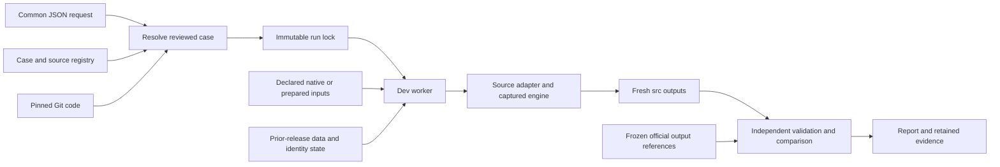

# Common historical replay interface

Status, November 6, 2026: implemented, with the first full common-interface integration passing for SNOMED September 2026. Production is unchanged. This first interface runs the characterized historical cases with their pinned legacy settings. It does not prepare arbitrary new releases, assign production IDs, execute insertion or promote a candidate.

## One request and configuration

The operator supplies the seven fields in [request.schema.json](request.schema.json). The resolver selects one exact source/version/case, resolves the engine to a full Git commit, validates the complete common configuration, and freezes the case, dependency manifests, source code, shared runtime and apparatus. Unknown fields, aliases such as `previous_version`, unsupported profiles, unreviewed revisions and unsupported cases fail before execution. Duplicate JSON keys and placeholders are rejected.

The [case catalog](case-catalog/index.json) currently contains NCIt October 2026 with the separately reviewed PT/order fixes; unchanged SNOMED September 2026; unchanged MTH 2026AA; and the separate MTH retained-identity correction with its mandatory independent correction audit integrated. The corrected MTH conversion completed through the common launcher; its first audit failed at startup, and a separately recorded audit-only recovery passed. The original failed job is preserved. MDR and RADLEX remain registered with their captured production contracts; source-specific baseline characterization precedes enabling their common execution cases.

For example, save this as `request.json`:

```json
{
  "schema_version": 1,
  "source": "SNOMEDCT_US",
  "version": "SNOMEDCT_US_2026_09_01",
  "engine_ref": "3b125edc1d29f7c7a91673da2a8d752bb0adff44",
  "case_variant": "as-produced",
  "reference_stage": "inversion-src",
  "comparison_profile": "exact"
}
```

Run these commands from a checkout of the review branch `test/inversion-replay-toolbox` (or a later integration containing its committed apparatus). The original workspace on `main` can contain documentation mirrors without that committed apparatus.

The selected engine commits must also be available in local Git. The MTH producer correction is on the separate `fix/mth-consistent-identity-state` branch at `b2611ab`; the runner branch stages its files from that commit, rather than incorporating those source edits into the runner's own source tree. Publishing the runner branch alone does not publish a separate, unreachable engine commit.

Install [the pinned resolver dependencies](../../tools/requirements-runner.txt) in a local Python 3.12 virtual environment. Remote execution uses the dev server's Python 3.9 standard library. Then:

```sh
python3 -B tools/inversion_request.py resolve request.json --run-id sct-replay-001 --output case.lock.json
python3 -B tools/inversion_request.py show case.lock.json
```

The resolver requires committed apparatus, schemas and case files; uncommitted worktree bytes cannot be labeled as code from HEAD. A lock file is created once, owner-readable and non-writable. Its content digest detects subsequent changes. This is integrity/provenance evidence within the trusted repository/account workflow, not a cryptographic signature or an authorization boundary against someone who controls that account.

## Data flow



Executable code comes from Git. A prior release contributes only its declared data or identity dependencies. An official current-version output contributes comparison evidence. An existing dev run of that same version is preserved separately before replacement.

## Dev lifecycle

Use an existing authenticated SSH control socket; no password is placed in a command or configuration. `--socket` below means that socket's actual local path.

```sh
python3 -B tools/inversion_remote.py --socket /path/to/dev.sock inspect-current case.lock.json --output previous-source.json
python3 -B tools/inversion_remote.py --socket /path/to/dev.sock activate-runtime case.lock.json --output runtime-activation.json
python3 -B tools/inversion_remote.py --socket /path/to/dev.sock submit case.lock.json --previous-receipt previous-source.json --output launch.json
python3 -B tools/inversion_remote.py --socket /path/to/dev.sock status --source SNOMEDCT_US --run-id sct-replay-001 --output status-001.json
python3 -B tools/inversion_remote.py --socket /path/to/dev.sock collect --source SNOMEDCT_US --run-id sct-replay-001 --output result-001.json
```

`inspect-current` is needed only when the canonical release folder already exists. Its previous-source receipt concerns the existing dev run of this same version; it is separate from `replacement_baseline`, `comparison_baseline` and prior-release identity inputs. It pins that predecessor's files, links and access modes; an unfinished run or changed predecessor is rejected. `submit` preserves the verified tree at `<version>.before-<run-id>` and stages a fresh candidate using Git code and declared input artifacts. Successful preservation masks write access while retaining existing read/execute restrictions. A preparation failure restores the old canonical tree if no new candidate was published; partial published candidates and their logs remain available for investigation. Run IDs, preserved folders, local evidence files and control records are never reused or overwritten.

Runtime activation is a separate explicit operation under the same global dev lock. It supports only the characterized original/stable-order `Hierarchy.pm` pair, verifies all 169 runtime files and preserves the previous bytes/receipt. Other runtime differences require review. An active inversion blocks activation and submission. No production path or host is accepted.

The worker holds the same runtime lock from preparation through comparison, including the handoff from launcher to worker and calls into the source adapters. Conversion processes have network disabled, bounded memory/time, disk/memory reserves and retained stdout/stderr. Archived input acquisition is the separate network-enabled step, using the existing download-only S3 helper and `meme` profile. Cached files are verified by their frozen hashes; a changed archive or prepared bundle cannot silently replace the selected input. A missing archive with a retained reference receipt remains subject to the existing acquisition tool's conservative restore guard and requires reconciliation rather than implicit re-freezing.

All data, code and output paths retain `/local/content/MEME/MEME5/...` and the canonical source/version layout. One explicit addition is `/local/content/MEME/MEME5/inv/qa/replay-requests/<run-id>` for persistent request/control evidence. Those records must survive replacement of a release directory. The inner legacy run records remain at their original source-specific QA paths. This addition does not relocate source data or inversion outputs.

## Retry only a failed MTH correction audit

The common interface can review an already completed corrected MTH conversion in a separately named audit-only run:

```sh
python3 -B tools/inversion_remote.py --socket /path/to/dev.sock retry-mth-audit --parent-run-id common-mth-corrections-20261106 --review-id common-mth-audit-review-20261109 --output audit-review-launch.json
python3 -B tools/inversion_remote.py --socket /path/to/dev.sock status --source MTH --run-id common-mth-audit-review-20261109 --output audit-review-status.json
python3 -B tools/inversion_remote.py --socket /path/to/dev.sock collect --source MTH --run-id common-mth-audit-review-20261109 --output audit-review-result.json
```

This operation requires the reviewed correction case, a failed audit status, all 23 completed outputs and clean core/identity validation. It freezes a new audit apparatus, pins the parent lock/raw-result/failed-status hashes and rechecks the source, inputs, runtime and outputs before auditing. The detached retry inherits the same global runtime lock. It preserves the parent raw result byte-for-byte and never regenerates or replaces source data. The result records conversion and audit apparatus identities separately, retains `original_common_run_status: failed`, and cannot approve insertion or production promotion. Existing review identities cannot be reused. Seventeen recovery checks pass locally/on dev, with 57 local request checks and real namespace tests. [Recovery evidence](audit-review-fixtures-20261109.json).

## Comparison and coverage

The reference is selected per output, not by assuming the archive is one workflow stage. NCIt uses October `src`; SNOMED uses `src/attributes.orig` before insertion enrichment; MTH uses its frozen six core outputs plus identity/history/helper outputs. The reference archive is never restored wholesale as the candidate. MTH prepared subset inputs and prior MTH_2025AB identity state are explicit dependencies; regeneration of those preserved inputs is not required.

`exact` cannot inherit a more permissive adapter verdict. NCIt's `semantic-strict` case retains its reviewed detailed rules for context ordering and generated CONTEXT attribute IDs; atom/relationship/merge content, duplicate counts, ID allocation checks and independent validation remain mandatory. MTH's original validation findings remain visible even when all official files match exactly. The corrected MTH case uses the separate `reviewed-corrections` profile. It cannot acquire a passing verdict just by matching its own first run.

For `reviewed-corrections`, the common worker preserves the complete original `DIFFERENCES_REQUIRE_REVIEW` result as read-only `raw-result.json`, then runs the pinned [native-derived MTH audit](mth-correction-audit.md) offline under the same runtime lock, with bounded memory/time and retained logs. All 23 characterized outputs, clean core/identity validation and the exact reviewed source/runtime revisions are mandatory. After the audit, input and output hashes are verified again. A successful report must identify this run, engine, apparatus and audit code before the common result can report `PASS_REVIEWED_CORRECTIONS`. The raw comparison remains unchanged. `collect` retrieves the raw result, correction audit and execution evidence alongside the final report. Audit failure leaves a failed common run with retained raw evidence; it cannot fall back to exact or semantic acceptance.

The first adapters stage already characterized legacy settings. General new-release configuration generation, policy extraction, metadata acquisition, legacy database QA, MDR/RADLEX characterization and production release management are subsequent work. Four real request locks have now been resolved and verified from committed apparatus `181ac6e`; see [resolution evidence](common-interface-resolution-20261106.json) and [executable request examples](request-examples/). The [MTH capsule-equivalence check](common-mth-capsule-equivalence.json) confirms that its common adapter resolves the same 57 code/link entries, 169 runtime hashes, frozen inputs and stage options as the executed correction capsule. This establishes translation coverage without relabeling the earlier execution. Earlier characterization runs retain their original apparatus identities and are not relabeled as common-run executions. NCIt still requires a complete common-launcher integration run. MTH has completed conversion and separate audit recovery; a single uninterrupted common run through its audit remains unproved.

## First completed common-interface run

`common-snomedct-us-1-20261106` completed on the separate dev server at 22:08 UTC on November 6. The request selected unchanged production engine `3b125ed`; the executed apparatus was `181ac6e`. The complete lifecycle took approximately 39 minutes, including preparation, fresh conversion, cleanup, comparison and final verification.

All five outputs match the frozen official references byte for byte: classes/atoms (1,048,850 rows), attributes (9,324,589), relationships (742,425), merge facts (1,048,849), and contexts (20,403,095). Attributes use the pre-insertion `src/attributes.orig` reference. Independent structure checks pass, with no ignored columns or reindexed identifiers. Inputs, source code, all 169 shared runtime files and outputs were verified again afterward. The result is `PASS_EXACT` for this bounded core case, with `production_eligible: false` and no insertion. [Full result](common-snomed-2026-09-01-result.json).

The previous canonical dev tree was verified and preserved at `SNOMEDCT_US_2026_09_01.before-common-snomedct-us-1-20261106`. The candidate started from Git code and 18 declared input files; generated outputs were not restored as candidate inputs. The selected archive was already cached and its frozen hash was verified. A subsequent actual `collect` command retrieved the completed JSON reports and matched the controller's result, preparation and acquisition receipts. [Lifecycle and collection evidence](common-snomed-2026-09-01-lifecycle.json). Collection retrieves reports; the generated `.src` files remain at the standard dev release path.


The live integration run exposed a status-reader gap: the outer lifecycle state covered execution/comparison, but the adapter's progress was hidden. The reader now includes the actual inner adapter progress and active phase, while keeping the persistent common control record authoritative. It reports comparison and final artifact verification explicitly. Twenty worker/status fixtures pass locally and on dev, and a live read confirms the comparison phase. This observer change does not alter a running capsule. [Status evidence](common-interface-status-fixtures-20261106.json).

A later readiness review found that the initial capsule omitted NCIt's `run_nci_core_replay.py` helper and the fixture dependency imported by the captured legacy advancement module. Both are now explicitly packaged. The resolver rejects missing repository Python imports before remote preparation. All 16 frozen modules import in isolation locally and on dev; a synthetic execution of the actual NCIt adapter entry records all five output hashes and calls its characterized acceptance rules. This is packaging/adapter coverage; the complete NCIt common-launcher run remains pending. The in-flight MTH capsule retains its original committed apparatus identity. [Dependency and adapter evidence](common-module-dependency-fixtures-20261106.json).

Common final verification now explicitly rehashes every compared output after comparison, alongside the declared input, engine, runtime and range checks. There are 53 local request checks and 27 worker checks locally/on dev, including rejection of output, metadata, engine or reference changes. The 55 MTH acceptance and 20 native-audit checks also pass, and actual live MTH status retrieval reports its running adapter stage. [Final verification evidence](common-final-verification-fixtures-20261106.json). These later apparatus changes do not replace the code frozen into a running or completed capsule.

## Corrected MTH conversion and audit recovery, November 9

The common conversion `common-mth-corrections-20261106` completed on November 7 UTC. Its 23 output hashes match the earlier corrected characterization, with clean independent core and identity checks. The audit then failed before inspecting data because its network-isolated process mapped the account to root, conflicting with the dev/tomcata guard. The guard remains enforced; the audit now preserves the current account inside its isolated network namespace. The [original failure](common-mth-2026aa-audit-startup-failure.json) is retained.

The separately named `common-mth-audit-review-20261109` completed at 17:56:46 UTC with `PASS_REVIEWED_CORRECTIONS`. It reused the completed conversion without rerunning or replacing source data, verified every frozen output, and preserved the parent raw comparison and failed status. The report distinguishes conversion apparatus `e3b24ec` from recovery apparatus `dd97ddc`. [Recovered audit result](common-mth-2026aa-audit-review-result.json), [lifecycle](common-mth-2026aa-audit-review-lifecycle.json). This establishes acceptance of this conversion plus recorded recovery; it does not relabel the original common job as successful or claim a single uninterrupted lifecycle.

## Reviewed capacity for the MTH integration replay

The retained MTH tree measures 10,536,967,996 bytes and the 23 compared outputs total 5,788,343,974 bytes. The reviewed MTH case now aligns the outer preflight with its existing adapter guard at 45 GiB free, using a 16 GiB native-tree allowance, 12 GiB comparison-or-audit scratch allowance and the unchanged 12 GiB per-stage reserve. Available dev space was 47.722 GiB; older trees are retained. Other cases keep the default 50 GiB guard unless their own source/version profile is explicitly reviewed. Six local/dev capacity fixtures reject unknown, lowered and cross-source profiles. [Measured footprint](common-integration-capacity-20261109.json), [capacity fixtures](common-capacity-fixtures-20261109.json).
