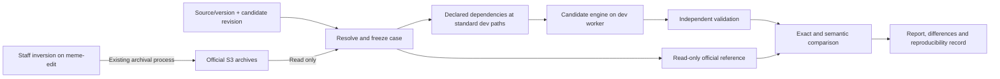

# Isolated inversion replay and comparison architecture

Status: proposed design, November 3, 2026. This document specifies the apparatus to build; the example commands and request format are not an implemented service. No server, database, archive, or staff workflow was changed for this design.

## Objective

During several production cycles, developers must be able to request an inversion of a source/version using candidate code, retrieve the corresponding official inversion from S3, and receive a reproducible comparison report. All candidate execution, scratch data, and comparison work should run on a separate development worker so staff can continue normal inversion work on meme-edit.

The first deliverable is a trustworthy replay/comparison apparatus around the existing engines. Parser rewrites follow it. A reference inversion is an observed official result, not an infallible correctness oracle: independent validation and explicit review of intentional corrections are also required.

The implementation baseline is a verified snapshot of the operational code on meme-edit, not an earlier project-rework branch. Capture the actual shared and source-specific code, configuration, policies, and runtime dependencies with provenance. The first baseline case must pair that code with a matching official result and preparation state. Older historical cases may need their archived production code to establish unchanged-engine behavior; record that identity separately from the candidate. See the [starting-point decision](assessment.md#implementation-starting-point-operational-code-on-meme-edit).

## Historical replay is not presumed impossible

Live database/API access is a potential external input, not proof that historical inversions cannot be reproduced. The October NCIt archive has now been frozen and inspected, but no candidate replay has run. Its native inputs and archived preparation metadata are present; code tracing separates the core conversion from later live-lookup QA/documentation steps. See [the case boundary](nci-reference-boundaries.md). Separate queries that influence output from queries used only for validation:

| Dependency | Observed use | Reproduction implication |
|---|---|---|
| RELA inverse/definition and TTY metadata | `MakeDoc.pm` queries these to generate MRDOC | Reuse historical definitions or captured responses to reproduce that output |
| Current source inventory and precedence | MTH preparation creates `ncimid.sources` and `ncimid.termgroups` | These files already exist in the inspected MTH directory and are candidate historical inputs to recover from its archive |
| Named NCImeta MRCONSO release | SNOMED wrapper derives ICD mapping-target inventories from a pinned release path | Restore that named reference data or the preserved derived inventories |
| Current source/ID-range QA queries | Legacy QA validates source metadata and ID bounds | Changed responses can change validation results without changing the generated `.src` content |

A complete database clone is unnecessary when the relevant historical values are available as files or captured API responses. Audit the selected case's inputs first. When a specific output-affecting value is absent, determine whether it can be recovered from a preserved export, historical database backup, or unambiguous archived metadata. Record any reconstruction and its provenance. Only then classify the exact remaining replay limitation.

Archived official MRDOC or other derived metadata may help reconstruct a narrow historical lookup fixture. A case using that fixture can test conversion under those supplied definitions, but it does not independently test historical metadata acquisition or certify the definitions themselves. State that coverage boundary explicitly.

The acceptance goal should distinguish byte-identical output, semantic output equivalence, and reproduction of the original QA report. Failure to reproduce historical QA against today's database does not establish failure to reproduce the inverter output.

## Deployment boundary

The user selected `ncias-d3777-c` and confirmed separate storage from production. Read-only inspection found 8 logical CPUs, about 31 GiB RAM, about 123 GiB free disk, working S3 metadata reads, and successful user/mount/network namespace creation. See [development-worker readiness](dev-worker-readiness.md). Start with one large-job worker, the standard meme-edit directory layout on dev, and read-only acquisition credentials. Measure the first case's expanded data and peak scratch requirements before accepting the capacity budget. Namespace creation was a capability probe, not a chosen filesystem layout.

The worker must not mount staff working directories writable, share production scratch space, call production mutation APIs, allocate production SAID ranges, update official S3 archive keys, or provision/recreate meme-test or meme-release. Historical runs can use the official ID range inside the isolated worker without making a new reservation. Any future importer acceptance tests require a separately owned disposable database and explicit test credentials.

Historical metadata/API responses should be supplied by versioned local files or a small local compatibility endpoint. Block candidate access to production NCImeta endpoints so a remaining hardcoded `latest` call fails visibly rather than changing the result or touching staff work. Provide only the credentials and network access required by the worker.

Mirror the physical production paths on the separate development host: shared code under `/local/content/MEME/MEME5/inv/INV` and `inv/ENV`, release folders under `inv/sources/<VSAB>`, and companion data under `mr/ncim/<release>` and `mr/umls/<release>`. Preserve the source-specific subdirectories and links. Path relocations or remapped physical roots require an explicit design decision; they are not part of initial setup. Process/network isolation can be added while preserving the mirrored paths. Merely using another subdirectory on meme-edit would not provide the selected separate-host isolation.

The release-folder inventories may differ between dev and production. A run selects its source/version and declared baselines, publisher history, identity state, and reference data. Reuse verified local dependencies and restore required absent ones. Extra folders do not block a run; do not synchronize folder sets, infer a dependency from a directory's presence, or remove unrelated versions to obtain parity.

Use the existing `pull_s3.csh` conventions and transfer implementation at the standard paths. Its fixed destinations fit the requested mirror, so an arbitrary-destination option is not initially required. Compare the dev tool copies with the pinned production versions before updating them. Official-reference acquisition needs read-only S3 operations; archive retention and receipts remain explicit test requirements, and push/update commands against official keys are excluded from replay.



The staff archival path remains the producer of official results. New cycle comparisons start after the appropriate official archive stage is available; they do not read or compete with staff's live working directory.

## A simple request and a resolved case

The routine operator request should specify only the source, version, candidate revision, and reference stage/profile. Proposed usage:

```text
invtest run requests/nci-october-2026.json
invtest status <run-id>
invtest report <run-id>
```

The proposed JSON format is in [request-template.json](request-template.json), with a [request schema](request.schema.json). The candidate commit placeholder must be replaced before submission. The source/version selects an entry from a reviewed case catalog; it does not infer the preceding month or choose a moving `latest` dependency.

The request expands into the [common inversion configuration](configuration.md), using the same schema and common field names for all three sources. Source profiles supply only genuinely source-specific settings. The complete `inversion.json` is resolved into a detailed `case.lock.json` containing:

- Candidate repository/commit, runtime package identity, and source-policy revision.
- Source/VSAB, native input identities, and exact configuration inputs.
- Replacement baseline, comparison baseline, required publisher-history interval, and prior identity maps.
- Historical NCImeta source/precedence exports, MRDOC definitions, and mapping-target inventory where required.
- Official archive keys, selected object versions where available, downloaded SHA-256 values, selected reference stage, and reference file inventory/checksums.
- Historical ID range and any other generator settings; comparator/profile revision and any reviewed change specification.
- Output expectations, resource limits, and the case's provenance limitations.

An unresolved historical dependency must be reported. It must not be filled from today's database, the newest local directory, or another month's release simply to make the test run.

For an NCIt August → October test, the catalog explicitly records August as the replacement baseline if that is the transition under test. September is optional comparison data. A strict replay case must reproduce the actual preparation inputs of its official reference; a separate corrected-transition case may deliberately change those inputs. The user's skipped-month example must not be mistaken for proof of the actual baseline used by every archived October inversion.

## Freeze the official reference

Reuse the archive locations already defined by the shared scripts: inversion archives under `inv/sources/<VSAB>.tgz`, with `.tar.gz` fallback for older archives, and companion NCImeta/UMLS data under their existing `mr` prefixes. The first October NCIt object has now been downloaded, hash-frozen, and inventoried at the standard path without extraction. Its [reference record](nci-reference-boundaries.md) identifies the actual bytes and preparation/output boundaries.

The `--update` archival workflow means the same named inversion object may acquire newer contents, including insertion logs or file changes. If S3 object versions are available, select one explicitly. Otherwise, retain a read-only local reference snapshot identified by the downloaded bytes' SHA-256. Once a case is locked, subsequent retries must reuse that frozen reference. Refreshing a reference creates a new case revision, with the difference visible.

Choose the reference stage explicitly:

| Stage | Meaning | Comparison requirement |
|---|---|---|
| `inversion-src` | Approved inverter output under the archived release's `src` directory | Candidate completes the equivalent inversion and declared preparation stages |
| `insertion-package` | Approved final insertion inputs, often under `insert`, including applicable later additions | Candidate also reproduces the declared enrichment/finalization steps |

Directory names alone do not prove which version or workflow state files represent. Capture the selected files' stage/version metadata and, where available, the release/insertion receipt or operator identification of the official package. The inspected October archive has October `src` metadata with August low source, while `insert` contains August-labeled source metadata with July low-source tags. Its `insert` set is not the October output oracle. Never silently fall back from missing `src` files to `insert` files. Validate required files, source version, and stage compatibility before running the candidate.

The retained official archive stays at the standard download path; fresh candidate output belongs in the standard release folder. No separate reference working root is required. The archive is read-only, checksum-identified, and excluded from candidate generation except for explicitly allowlisted native/preparation inputs. Candidate output cannot replace or update the reference. Do not seed candidate generated files by extracting completed official outputs.

Historical archives may contain manually curated metadata that is a legitimate input to the old workflow. Distinguish two case types:

1. **Transformation replay:** uses declared, archived preparation metadata to test equivalent conversion logic.
2. **Full workflow replay:** regenerates that metadata from declared policies and earlier inputs as well.

Report which type ran. Copying official generated atoms, relationships, attributes, or contexts into the candidate output is never a valid replay. A transformation replay must not be presented as proof that metadata preparation was tested end to end.

## Worker layout and execution

The operational development tree mirrors meme-edit:

```text
/local/content/MEME/MEME5/
  inv/
    INV/                             # Pinned shared inversion code
    ENV/                             # Environment framework
    sources/<VSAB>/                  # Only selected releases and dependencies are needed
      bin/ etc/ orig/ tmp/ src/ insert/   # Source-specific conventions retained
    archive/projects/TDE_QA/          # Existing shared QA location
  mr/
    ncim/<release>/
    umls/<release>/
  ncim/bin/                          # Existing archive tools
```

The apparatus also needs a request, complete `inversion.json`, immutable `case.lock.json`, frozen reference identity/content, validation/comparison results, logs, and reports. These are logical artifact roles; a separate physical `dev-root` is not implied. Choose their retention and physical locations explicitly when implementing the apparatus, while preserving the operational paths above. A candidate must not overwrite the only frozen official reference. The exact reference-acquisition and retention plan must be settled before executing a replay.

Run sequence:

1. Validate the request, resolve the case, and verify reference-stage compatibility.
2. Acquire the official archive and companion data through existing transfer tooling; freeze/check the reference and input identities.
3. Prepare the pinned engine/runtime at the standard dev paths and verify only the declared release/dependency folders. Preserve native/reference inputs; legacy steps that patch inputs require an explicit derived-copy plan within the agreed layout.
4. Execute candidate stages with pinned configuration and historical IDs/metadata, collecting command status, logs, timings, resource use, and stage receipts.
5. Run independent structural, identity, range, reference, and source-policy validation.
6. Compare the newly generated output with the frozen official output, including per-file and semantic differences.
7. Produce the report and preserve the inputs/receipts needed to reproduce it. A new candidate commit always receives a new run identity.

The UMLS restore currently removes `DVDIMAGE/jre`; the MTH engine's expected Java runtime must therefore be supplied explicitly. Historical runtime support is part of the case, not a reason to source an arbitrary current Java installation.

Start by serializing full inversions. Add concurrency only after measuring resource use and confirming that scratch paths, archive operations, and any fixed temporary filenames cannot collide. The inspected SNOMED context output alone is about 6.22 GB. Capacity planning must include compressed downloads, extracted native/prior data, official files, candidate files, and external-sort/comparison space. Benchmark before choosing a machine size or promising concurrent throughput.

## Comparison architecture

### 1. Artifact and structural comparison

Record every required file's presence, size, SHA-256, record count, field-count distribution, encoding, and schema/dialect validation. Missing required files or malformed records fail even when a content comparison could otherwise proceed.

Exact equality is the strongest useful initial target when replaying unchanged code with the same input ordering and IDs. Where ordering differs, compare sorted multisets of parsed records. Do not use set comparison or `sort -u`: both hide duplicate additions or losses. Preserve meaningful null/trailing-field distinctions and flag values.

### 2. Generated-identifier correspondence

Prefer reproducing the historical ID range and deterministic generation order in isolated runs. When a legitimate implementation change reorders generated IDs, build an explicit correspondence using source-asserted identifiers and complete record meaning. Source/termgroup, code, language, text, flags, and source identifiers help establish identity; term text alone is not a sufficient key.

Apply correspondence consistently across atoms, attributes, relationship endpoints, merge facts, and context paths, including structured identifiers embedded in values. Preserve identifier types, qualifiers, source scope, and current/previous CUI distinctions. Map other generated record IDs wherever they are referenced.

Ambiguous matches must be reported rather than resolved by choosing the first record. Repeated identical atoms require multiplicity-aware handling and, where needed, relationship/context structure to distinguish correspondence. The initial comparator may classify unsupported ambiguity for review instead of claiming equivalence. Never globally strip numeric IDs, order fields, source IDs, or hashes to make a comparison pass.

### 3. Semantic comparison

| Output | Preserve and compare |
|---|---|
| Atoms | Source, TTY, code, text, language, asserted identifiers, flags, meaningful order/CUI fields, and multiplicity |
| Attributes | Referenced entity, type/qualifier, name/value, source, flags, asserted ID and required digest semantics |
| Relationships | Direction, endpoint identity/type/qualifier, REL/RELA, source/label source, source RUI, group membership, and multiplicity |
| Merges and histories | Merge targets, sets, flags and scopes; MTH moved-AUI/CUI and bequeathal transitions |
| Contexts | Hierarchy paths, roots, endpoints, group/source information, and repeated paths where meaningful |
| Metadata | Source lineage/precedence, source family, termgroups, MRDOC definitions and reciprocal inverses |

Relationship group numbers may change while group membership stays the same. If a source permits this, its profile must compare the grouped edge structure and distinguish incidental group labels from asserted identifiers. It must not simply discard the group field.

Normalization rules must be narrow and versioned. Sorting and declared generated-ID remapping can be legitimate; lowercasing all terms, rewriting Unicode, dropping null fields, suppressing duplicate records, or ignoring all timestamps/IDs can hide semantic changes. Retain raw differences alongside normalized results.

`findSrcDiffs.pl`/`SrcDiffs.pm` contains useful existing identity-mapping and comparison logic. Characterize and reuse suitable parts, but do not accept it as the sole comparator: the review found local runtime incompatibility, implicit paths, configurable exclusions, and a duplicate-atom bailout. Test the comparator itself with deliberately changed records and duplicates.

### 4. Acceptance and review

Report comparison and independent validation as separate results. Suggested result states:

- `PASS_EQUIVALENT`: required validation passed and all required files/semantics match under the declared profile.
- `MATCHES_REFERENCE_WITH_FINDINGS`: output matches the official reference but independent validation found unresolved issues. This is not a release acceptance result.
- `PASS_REVIEWED_CHANGE`: validation passed and every difference matches a separately reviewed change specification with selectors/count constraints.
- `REVIEW_REQUIRED`: differences or identifier ambiguities remain unclassified.
- `FAIL`: execution, acquisition, structure, integrity, or a mandatory invariant failed.

The candidate cannot modify its own change specification to convert a failure into a pass. An intended correction to an official defect should have its own correctness fixture as well as a constrained expected-difference rule. Avoid blanket rule exclusions, whole-file waivers, and percentage-of-rows-matched acceptance.

## Reports and daily use

Each run should produce a short `report.md` plus machine-readable `result.json`, linked detailed differences, and logs. The report should include source/version, candidate commit/runtime, case/reference revision, baseline roles, reference stage, input/output hashes, validation status, raw/semantic comparison status, additions/deletions/changes by file and source category, and actionable samples.

Keep full difference files downloadable rather than flooding the summary with millions of records. Group examples by change type and link back to input/source identifiers. Include timing, peak resource observations where available, and enough run identity to repeat the request.

Developers can submit requests through a CLI or a simple CI job with the same fields. Start with a file-backed queue/one worker and stored run directories; add a web interface or scheduler only when necessary. A model/skill may help explain reports, but it does not calculate the comparison or decide whether mandatory checks passed.

## Test layers and first milestone

| Layer | Purpose | When |
|---|---|---|
| Small synthetic/curated fixtures | Test parsers, serializers, validators, ID correspondence and deliberate corruption | Each relevant change |
| Source component cases | Exercise NCIt groups/metadata, SNOMED refsets/maps, MTH disposition/history reconciliation | Each relevant adapter change |
| Full historical replay | Compare candidate output against frozen official S3 output | Selected commits and milestone gates |
| New-cycle shadow run | Exercise the updated code independently against the same released inputs used by staff | Each selected production cycle after official reference availability |
| Isolated importer acceptance | Verify loading and downstream semantics in a disposable test environment | Source cutover gates, after replay checks |

The first full case should run unchanged legacy NCIt code on the development worker, using a fully identified archived release and matching preparation state. It must match the frozen official reference to the extent supported by the declared comparison profile. If it does not, resolve input/runtime/provenance differences before judging candidate rewrites.

Then prove the apparatus detects an intentionally missing atom, an extra duplicate, reversed relationship direction, changed group membership, broken reference, and incorrect metadata baseline. These checks validate the comparator rather than merely demonstrating that identical files compare equal.

Expand to NCIt skipped-month scenarios, SNOMED direct RF2 releases with a pinned mapping-target inventory, and MTH cases with updated/kept sources plus moved-AUI/CUI history. Maintain a small set of frozen historical cases across the coming months, and add official new-cycle references without replacing the old ones.

## Impact on the migration plan

The isolated worker, request/lock format, baseline replay, comparator, and negative comparator fixtures are early deliverables under priorities 1 and 2. They must be available before substantial semantic rewrites and can be built while staff continues production inversions. Priority 3 expands the same apparatus into the common operational lifecycle; it should not introduce a second incompatible manifest or runner.

The development host is selected, its storage separation is user-confirmed, and the shared-code layout mirrors meme-edit. AWS authentication and selected S3 list/head reads have passed. Remaining setup includes the source-specific case/runtime dependencies, an explicit reference/artifact retention plan, a read-only acquisition identity or scoped session, the first complete reference case, historical metadata snapshots, a measured capacity budget, and ownership of any future disposable importer database. These tasks can proceed without interrupting staff's inversion directories or introducing candidate changes on meme-edit.

The initial shared-runtime setup is complete: 169 pinned `INV`/`ENV` files were verified at the standard dev paths, Bash/tcsh activation passes, and selected NCIt scripts pass offline syntax checks. NCIt source-data acquisition, archive-tool reconciliation, explicit metadata fixtures, offline core execution and scoped comparison are now implemented. The current ordering candidate changes one shared module and has its own runtime receipt. See [the setup record](dev-shared-runtime-setup.md) and [current comparison](nci-2026-10d-context-order-summary.json). The general request/lock runner and other sources' execution remain future work.

## First implemented characterization

The bounded October NCIt replay and [completed comparison](nci-reference-boundaries.md#completed-core-comparison) exercise a subset of this architecture at standard dev paths. It has pinned code/input/reference hashes, offline conversion, stage receipts, full-record multiset comparison, a narrowly scoped generated attribute-ID diagnostic, structural/reference checks, 17 comparison fixtures, and 21 preservation/profile checks. It is not yet the common request/lock runner or a complete semantic validator.

The comparison rejected the unchanged baseline for one missing FDA PT term type even though all counts agreed and every other content record matched. Separate explicit-PT and context-ordering fixes now pass full October core comparison. The first-record PT regression, combined source/SRC termgroup validation, and four-seed hierarchy regression protect these changes. The unchanged baseline result and previous candidate outputs remain preserved. [Current result](nci-2026-10d-context-order-summary.json)

## Insertion enrichment can modify the archived src directory

The user confirmed that semantic types are appended to the original attributes file during data insertion. The SNOMED September archive proves this concrete distinction: `src/attributes.orig` (9,324,589 rows) is the exact prefix of final `src/attributes.src` (10,458,314 rows); the additional 1,133,725 rows are SEMANTIC_TYPE attributes. Archived test outputs also contain `sty_term_ids` and `new_sty_defaults`.

For an inversion replay, explicitly bind canonical output `attributes.src` to the pre-enrichment reference member `src/attributes.orig`. Do not remove all semantic-type records during comparison: the original file already has a legitimate SRC semantic-type record. Insertion enrichment belongs to a separate stage with its own historical inputs/state and validation. Directory names alone do not establish a file's lifecycle stage. Preserve and hash stage outputs before any later insertion step changes the active files. The common configuration/case catalog must support explicit per-output reference members.

## SNOMED exact core reproduction

The September unchanged-production engine and original attribute cleanup have now reproduced all five official core files byte-for-byte, using declared archived RF2 inputs, source/termgroup metadata and ICD target inventories. No generated IDs, fields or duplicate records were omitted from comparison. The candidate remained at the mirrored source path; its preexisting NCIt candidate library/receipt was preserved before restoring all 169 baseline shared files. Conversion and cleanup ran with networking disabled and measured resource reserves. [Result](snomedct-us-2026-09-01-baseline-summary.json)

The initial structural scan exposed an apparatus defect: its allowed lists omitted SRC/VSY and ROOT_SOURCE_AUI, both explicitly supported by production framework/type rules and deliberately emitted here. The original scan/report is preserved. A separate review reclassifies only those tokens from complete scan counters with source hashes and prior-total checks. The corrected checker has two additional regression cases, 25 passing locally; it has not had another full-file execution. [Review evidence](snomedct-us-2026-09-01-validation-review.json) Future shared validation should derive these source-independent format/type rules from a reviewed versioned registry rather than reproduce incomplete per-source lists.

This proves the bounded transformation can be reproduced from frozen preparation inputs. It does not prove that today's database can regenerate historical source metadata/ICD inventories, or cover MRDOC, legacy/API QA, insertion or release eligibility. The common configuration/runner and MTH case remain future work.
